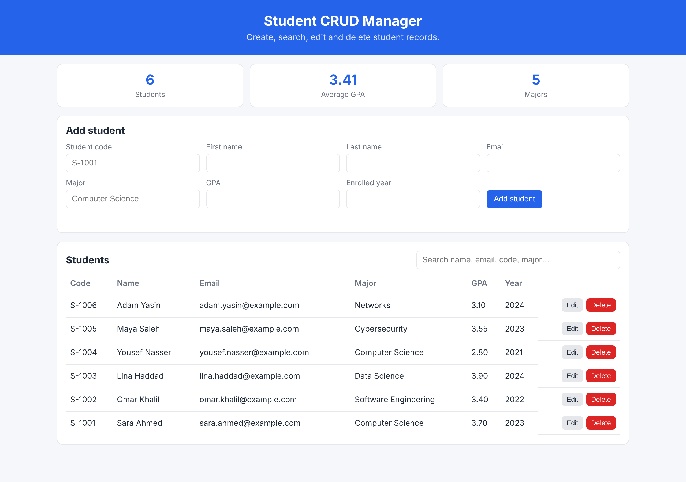

# Student CRUD Manager

[](https://github.com/mahmoud20820055-crypto/Student_Curd/actions/workflows/docker-ci.yml)

A containerised web application and REST API for managing university student records.
You can **create, list, search, edit and delete** students (code, name, email, major, GPA,
enrolment year). A dashboard shows the total number of students, the average GPA and the number of majors.
Data is stored in SQLite on a Docker volume, so it survives container restarts.



---

## Tech stack

| Layer      | Technology                                   |
|------------|----------------------------------------------|
| Language   | Python 3.12                                  |
| Framework  | Flask 3 (REST API + server-rendered page)    |
| Database   | SQLite (file on a Docker volume)             |
| Server     | Gunicorn (production WSGI server)            |
| Frontend   | HTML, CSS, vanilla JavaScript (Fetch API)    |
| Tests      | pytest (run inside a Docker build stage)     |
| DevOps     | Docker (multi-stage), Docker Compose, Make, GitHub Actions |

## Project structure

```
Student_Curd/
├─ src/
│  ├─ app/
│  │  ├─ __init__.py        # Flask application factory
│  │  ├─ db.py              # SQLite connection + schema
│  │  ├─ routes.py          # REST API, /health and web UI routes
│  │  ├─ validation.py      # input validation
│  │  ├─ templates/index.html
│  │  └─ static/            # app.js, style.css
│  └─ wsgi.py               # entry point for gunicorn
├─ tests/                   # pytest test suite
├─ docs/
│  ├─ screenshots/          # assignment evidence
│  └─ notes.md              # technical notes
├─ .github/workflows/docker-ci.yml
├─ Dockerfile               # multi-stage: builder -> test -> runtime
├─ docker-compose.yml
├─ Makefile
├─ requirements.txt / requirements-dev.txt
├─ .dockerignore / .gitignore
└─ LICENSE
```

---

## Quick start (Docker)

**Prerequisites:** Docker 23+ (BuildKit enabled by default). Nothing else is needed: no Python install.

```bash
git clone https://github.com/mahmoud20820055-crypto/Student_Curd.git
cd Student_Curd
```

### Option 1: plain Docker

```bash
# 1. Build the image
docker build -t student-crud-manager:latest .

# 2. Run the container (port 8000, data kept in the "student-data" volume)
docker run -d --name student-crud -p 8000:8000 -v student-data:/app/data student-crud-manager:latest

# 3. Check that it is up and healthy (STATUS should show "(healthy)" after ~10 s)
docker ps
```

Open **http://localhost:8000**.

### Option 2: Docker Compose

```bash
docker compose up -d --build
docker compose ps
```

### Option 3: Makefile shortcuts

```bash
make build   # build image
make test    # run the test suite inside Docker
make run     # start container on http://localhost:8000
make status  # show container status + health
make logs    # follow logs
make stop    # stop and remove the container
make clean   # stop, remove images and the data volume
make help    # list all targets
```

### Run the tests in Docker

The Dockerfile has a dedicated `test` stage that runs pytest during the build:

```bash
docker build --target test -t student-crud-manager:test .
```

---

## Stop and clean up

```bash
# Plain Docker
docker stop student-crud
docker rm student-crud
docker volume rm student-data          # optional: deletes all saved students
docker rmi student-crud-manager:latest # optional: remove the image

# Docker Compose
docker compose down        # stop and remove the container (keeps data)
docker compose down -v     # also remove the data volume
```

---

## Configuration

| Setting            | Default                  | Description                                        |
|--------------------|--------------------------|----------------------------------------------------|
| Container port     | `8000`                   | Port gunicorn listens on (`PORT` env var)           |
| `HOST_PORT`        | `8000`                   | Host port used by Docker Compose (`HOST_PORT=9000 docker compose up -d`) |
| `DATABASE_PATH`    | `/app/data/students.db`  | SQLite file location inside the container          |
| `GUNICORN_WORKERS` | `2`                      | Number of gunicorn worker processes                |
| Volume             | `/app/data`              | Mount a volume here to persist data                |

No secrets or external services are required.

To use a different host port with plain Docker: `docker run -d -p 9000:8000 ...` and open http://localhost:9000.

> **Behind a corporate/TLS-intercepting proxy?** If `pip install` fails with
> `CERTIFICATE_VERIFY_FAILED` during the build, pass your proxy's CA bundle as a build secret.
> It is used only while building and is never stored in the image:
> `docker build --secret id=pip_ca,src=/path/to/ca.crt -t student-crud-manager .`
> (or `make build PIP_CA=/path/to/ca.crt`).

---

## How to test it

### 1. Web UI
1. Open http://localhost:8000.
2. Fill in the **Add student** form and click **Add student**. The student appears in the table and the stats update.
3. Click **Edit** on a row, change a field (e.g. GPA), then click **Save changes**.
4. Type in the search box (e.g. `computer`) to filter by name, email, code or major.
5. Click **Delete** to remove a student.

### 2. Health check
```bash
curl http://localhost:8000/health
# {"status":"ok","database":"ok"}
```

### 3. REST API

| Method | Endpoint                    | Description                                  |
|--------|-----------------------------|----------------------------------------------|
| GET    | `/api/students`             | List students (optional `?q=` search)        |
| GET    | `/api/students/<id>`        | Get one student                              |
| POST   | `/api/students`             | Create a student (all fields required)       |
| PUT    | `/api/students/<id>`        | Replace a student (all fields required)      |
| PATCH  | `/api/students/<id>`        | Update some fields                           |
| DELETE | `/api/students/<id>`        | Delete a student                             |
| GET    | `/api/stats`                | Total students, average GPA, number of majors |
| GET    | `/health`                   | Health check used by Docker `HEALTHCHECK`    |

```bash
# Create
curl -X POST http://localhost:8000/api/students \
  -H "Content-Type: application/json" \
  -d '{"student_code":"S-1001","first_name":"Sara","last_name":"Ahmed","email":"sara.ahmed@example.com","major":"Computer Science","gpa":3.7,"enrolled_year":2023}'

# List / search
curl http://localhost:8000/api/students
curl "http://localhost:8000/api/students?q=sara"

# Partial update
curl -X PATCH http://localhost:8000/api/students/1 -H "Content-Type: application/json" -d '{"gpa":3.9}'

# Delete
curl -X DELETE http://localhost:8000/api/students/1
```

Validation errors return `400` with details per field. A duplicate email or student code returns `409`.
An unknown id returns `404`.

---

## Docker design highlights

- **Multi-stage build:** `builder` installs dependencies into a virtualenv. `test` runs pytest.
  `runtime` copies only the virtualenv and `src/` onto a fresh `python:3.12-slim` image.
- **Non-root user:** the app runs as the unprivileged `app` user.
- **Healthcheck:** `HEALTHCHECK` calls `/health`, which also checks the database connection.
- **Small build context:** `.dockerignore` excludes git history, docs, tests and local data.
- **Production server:** gunicorn runs as PID 1 (`exec`), so `docker stop` shuts it down cleanly.
- **Persistent data:** SQLite lives in the `/app/data` volume.
- **CI:** GitHub Actions runs the test stage, builds the runtime image and smoke-tests the running container on every push and pull request to `main`.

## Screenshots

| Evidence | File |
|----------|------|
| Docker build success | [01-docker-build-success.png](docs/screenshots/01-docker-build-success.png) |
| Tests passing inside Docker | [02-docker-tests-passing.png](docs/screenshots/02-docker-tests-passing.png) |
| Container running (healthy) | [03-container-running-healthy.png](docs/screenshots/03-container-running-healthy.png) |
| API responses | [04-api-responses.png](docs/screenshots/04-api-responses.png) |
| Web UI: student list | [05-web-ui-student-list.png](docs/screenshots/05-web-ui-student-list.png) |
| Web UI: editing a student | [06-web-ui-edit-student.png](docs/screenshots/06-web-ui-edit-student.png) |
| Web UI: search | [07-web-ui-search.png](docs/screenshots/07-web-ui-search.png) |
| Git commit history | [08-git-commit-history.png](docs/screenshots/08-git-commit-history.png) |

## Local development (without Docker, optional)

```bash
python -m venv .venv && source .venv/bin/activate
pip install -r requirements-dev.txt
python -m pytest -q tests
python src/wsgi.py        # http://localhost:8000
```

## Attribution

This project was written from scratch for the OS Lab Assignment #2 (Docker & GitHub).
It is not based on an existing open-source project. It uses these open-source libraries:
[Flask](https://flask.palletsprojects.com/) (BSD-3-Clause), [Gunicorn](https://gunicorn.org/) (MIT)
and [pytest](https://pytest.org/) (MIT), plus the official
[`python`](https://hub.docker.com/_/python) Docker image.

## License

Released under the [MIT License](LICENSE).
